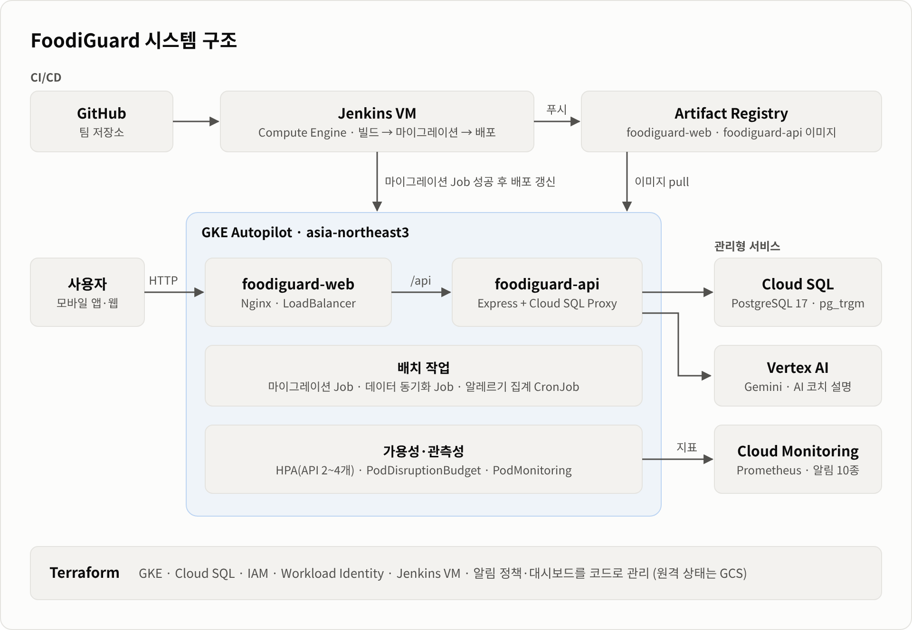
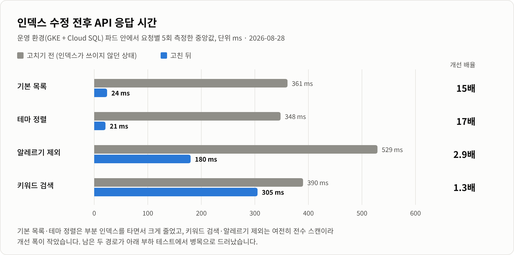
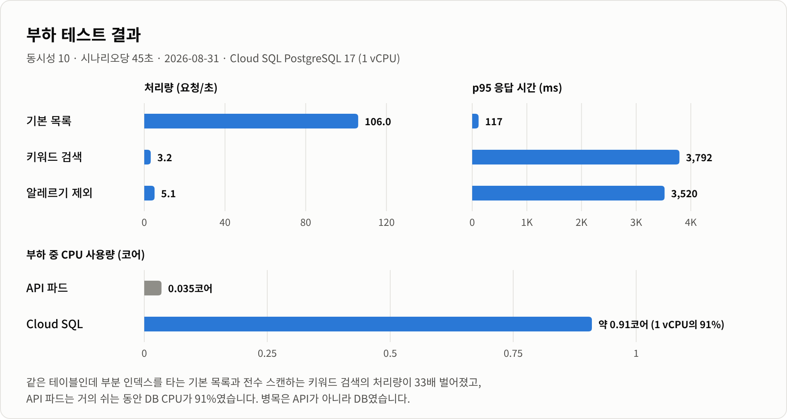
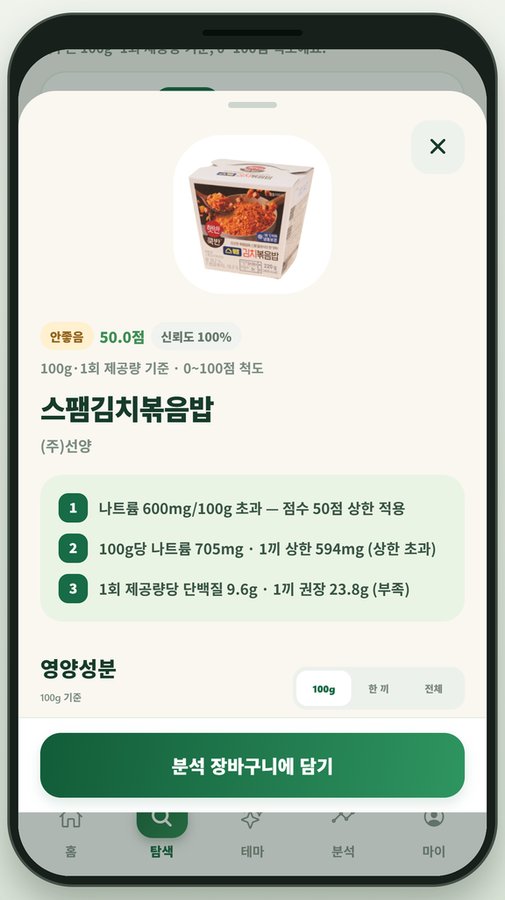
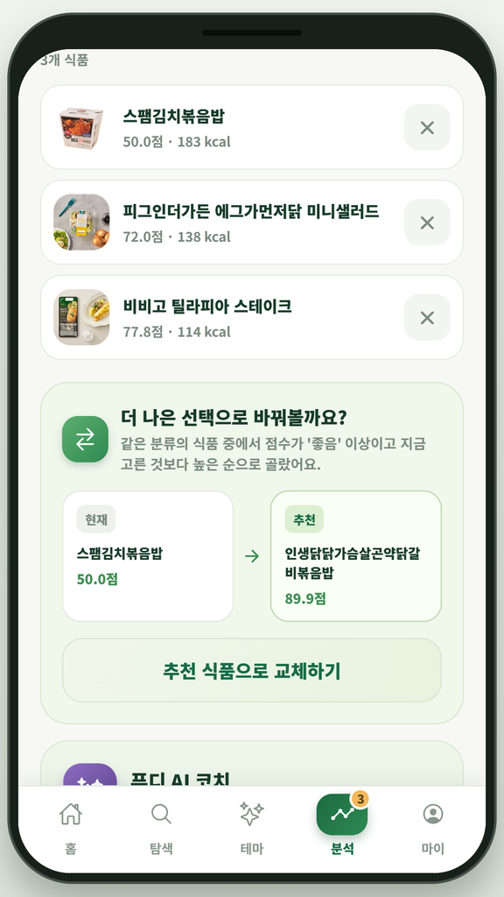
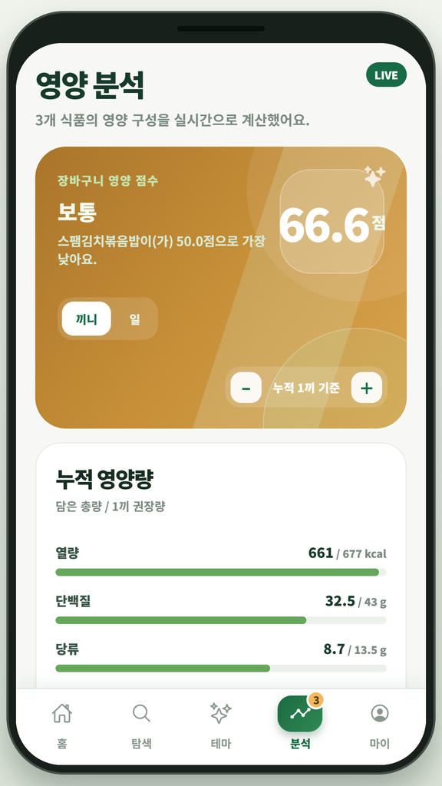
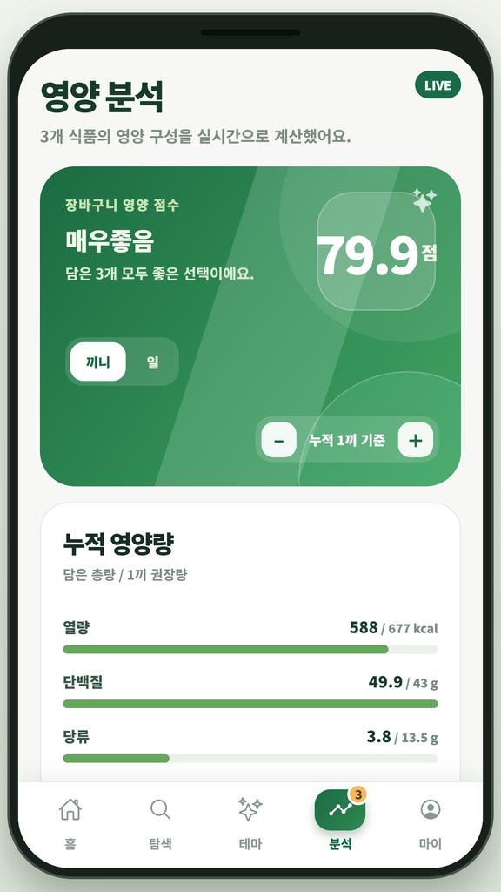

# GKE 기반 건강식 장바구니 분석 서비스 FoodiGuard

팀 프로젝트입니다.  
식약처 통합식품영양성분 DB와 품목제조보고 원재료 DB를 매칭한 **식품 79,041건(원재료 약 90만 행)** 을 기반으로 식품 검색, 개별 식품 점수, 원재료·알레르기 분석, 장바구니 영양 분석과 대체식품 추천을 제공하는 모바일 서비스입니다.

앱을 만드는 데서 끝내지 않고, **GCP 위에 배포하고(GKE·Cloud SQL), 자동 배포(Jenkins)와 인프라 코드(Terraform)를 갖추고, 모니터링·부하 테스트·장애 실험으로 운영 가능성을 검증**하는 데까지 진행했습니다.  
앞서 만든 [LangGraph 기반 식단 추천 AI 에이전트](https://github.com/bbvixx0509/portfolio/tree/main/LangGraph%20%EA%B8%B0%EB%B0%98%20%EC%8B%9D%EB%8B%A8%20%EC%B6%94%EC%B2%9C%20AI%20%EC%97%90%EC%9D%B4%EC%A0%84%ED%8A%B8)를 클라우드 서비스로 확장한 프로젝트이기도 합니다.

> 원본은 팀 저장소에서 개발했고, 이 폴더는 포트폴리오용으로 옮긴 사본입니다. GCP 프로젝트 ID와 프로젝트 번호, 외부 IP, 이메일, 알림 채널·정책 ID, 팀 저장소 주소는 예시 값으로 바꿨고, 연구대상자 설명문 본문은 싣지 않았습니다.

## 프로젝트 개요

장을 볼 때 식품 하나하나의 영양성분과 원재료를 확인하기는 어렵고, 장바구니 전체로 보면 하루 권장량 대비 얼마나 먹게 되는지 알기 더 어렵습니다.  
FoodiGuard는 식품을 검색하거나 장바구니에 담으면 영양성분과 원재료에서 파생한 위험 요소(첨가당, 감미료, 정제 탄수화물, 나트륨 첨가물, 보존료)를 점수로 보여주고, 알레르기 식품을 제외한 더 나은 대체식품을 추천합니다.

## 내가 맡은 역할

모바일 앱과 API는 팀원들과 함께 개발했습니다. 그중 저는 **클라우드 운영, 즉 쿠버네티스(GKE)와 GCP 플랫폼을 다루는 작업**을 주로 맡았습니다.

| 영역 | 참여 |
| --- | --- |
| 클라우드 운영 (GKE, Jenkins 파이프라인, Terraform, 모니터링) | 주로 맡은 영역 |
| 서비스 개발 (모바일 앱, API) | 팀 공동 개발 |

### 쿠버네티스 운영·신뢰성 (GKE)

- GKE Autopilot 배포 설정(HPA 오토스케일링, PodDisruptionBudget, 마이그레이션·데이터 동기화 Job, 알레르기 집계 CronJob)을 구성하고 운영했습니다. API 배포 설정(`backend-deployment.yaml`, `migration-job.yaml`)을 고치고, 배포를 새 GCP 프로젝트로 옮겼습니다.
- API는 HPA로 **최소 2개에서 최대 4개**까지(CPU 사용률 65% 기준) 늘어나고, 롤링 업데이트는 `maxUnavailable: 0`으로 기존 파드를 먼저 내리지 않습니다. PDB는 노드 교체 중에도 API와 웹 파드를 최소 1개씩 유지합니다.
- 스키마 변경은 배포와 분리한 **마이그레이션 Job**으로, 알레르기 집계는 매일 03:00에 도는 **CronJob**(중복 실행 금지)으로 실행합니다. API 파드에는 Cloud SQL Proxy 사이드카와 startup·readiness·liveness probe를 두었습니다.
- 파드가 서비스 계정 키 파일 없이 GCP 권한을 쓰도록 **Workload Identity**(`workload_identity.tf`)를 구성했습니다.
- API 파드를 강제로 삭제하는 장애 실험과 부하 테스트로 운영 상태를 검증하고 결과를 기록했습니다. 복제본이 1개라 약 4초 정지가 생긴다는 실험 결과가 API 복제본 2개 이상과 PDB 적용으로 이어졌습니다. ([SRE 검증 기록](./docs/sre-validation.md))

### CI/CD 파이프라인 (Jenkins)

- **마이그레이션이 성공한 경우에만 배포를 갱신**하는 Jenkins 파이프라인(`Jenkinsfile`)을 구성했습니다. 이미지 빌드 → 회귀 테스트 → Artifact Registry 푸시 → Secret 확인 → DB 마이그레이션 Job → 배포 순서로 진행해, 스키마와 코드가 어긋난 상태로 나가지 않습니다.
- main에 합친 코드가 배포되지 않던 문제를 팀원과 함께 Jenkins 폴링 로그로 추적했습니다. Job 설정에는 main이 지정돼 있었지만, 파이프라인이 마지막 빌드의 저장소 정보를 기억해 예전 작업 브랜치를 계속 비교하고 있었습니다. main 커밋으로 첫 빌드를 실행해 해소했고(백엔드 78개·모바일 40개 테스트와 마이그레이션 포함 6분 46초), 이후 PR 병합에서 수동 실행 없이 빌드가 시작되는 것까지 확인했습니다.
- 그 과정에서 Secret 확인 단계의 셸 출력에 인코딩된 비밀값이 남을 수 있다는 것을 찾아, 해당 구간의 출력을 끄고 **가짜 값으로 노출 여부와 필수 키 누락을 확인하는 회귀 테스트 10개**(`infra/tests/jenkins-secret-logging.test.mjs`)를 파이프라인의 테스트 단계에 넣었습니다. ([운영 반영 기록](./docs/operations-rollout-2026-09-08.md))

### 인프라 코드·관측성 (Terraform, Prometheus)

- GKE·Cloud SQL·IAM·Jenkins VM·모니터링을 Terraform으로 관리했습니다. 콘솔에서 따로 관리하던 Cloud Monitoring 알림 정책을 코드(`monitoring.tf`)로 옮기고, 새 프로젝트로 옮길 때 프로젝트 의존 값을 변수로 분리했습니다. GKE·Cloud SQL·Artifact Registry·Jenkins VM에는 비용 추적용 라벨을 붙였습니다.
- API에 Prometheus 메트릭을 노출하고 GKE 관리형 수집(`PodMonitoring`)을 연결했습니다. 트래픽이 없을 때도 지표가 끊기지 않도록 합성 트래픽 파드를 추가했습니다.
- 서비스가 죽는 것만이 아니라 **데이터가 오래되는 것**도 보이도록 데이터 품질 대시보드(`monitoring_dashboard.tf`)와 적재 중단 알림을 추가했습니다.
- 컨테이너 빌드를 고치고 Docker Compose 배포 구성, 관리형 PostgreSQL 지원, 작은 인스턴스에서도 버티는 헬스체크를 만들었습니다.

### 데이터베이스 성능

- 팀에서 진행한 검색 성능 개선을 운영 환경에서 다시 측정하다가, 앱이 실제로 거치는 DB 뷰에서는 **부분 인덱스가 한 번도 쓰이지 않던 문제**를 실행계획으로 찾아 고쳤습니다. 기본 목록 응답이 운영 환경에서 361ms → 24ms(약 15배)로 줄었습니다. ([성능 기록](./docs/performance.md))
- 이후 부하 테스트에서 API 파드 CPU는 0.035코어인데 Cloud SQL CPU는 91%인 것을 확인해, 키워드 검색·알레르기 제외처럼 아직 전수 스캔하는 경로의 병목이 API가 아니라 DB라는 것을 측정으로 밝혔습니다.

### 서비스 개발 (팀 공동)

- Expo(React Native) 기반 모바일 앱을 처음 구성하고, 웹 버전(Vite)을 정리해 모바일 앱 하나로 통합했습니다.
- 새 식품 DB 스키마에 맞춰 원재료·알레르기 기능을 연결하고, 가중합 방식이던 추천기를 **하드 필터 + 점수 정렬** 방식으로 바꾸고 대체식품 API를 만들었습니다.
- 건강 정보를 저장하기 전에 명시적 동의를 받는 화면과 프로필 소유권 검증을 추가했습니다.

## 문제 해결 사례

운영하면서 만난 문제 네 가지를 문제, 원인을 찾은 과정, 판단, 결과 순서로 정리했습니다.

### 1. main에 합친 코드가 배포되지 않았다

- **문제**: 작업 브랜치를 main에 합쳤는데 Jenkins가 배포를 시작하지 않았습니다.
- **원인을 찾은 과정**: 처음에는 Job 설정을 의심했지만 브랜치(`*/main`), Jenkinsfile 경로, 5분 주기 폴링이 모두 맞게 돼 있었습니다. 그래서 설정 화면 대신 폴링 로그를 봤고, main이 아니라 예전 작업 브랜치를 계속 비교하며 "No changes"로 끝나는 것을 찾았습니다. Jenkins 문서에서 파이프라인이 마지막 빌드에 쓴 저장소 정보를 기억해 폴링한다는 것을 확인했습니다.
- **판단**: main으로 빌드를 한 번 실행하면 풀리는 문제였습니다. 다만 수동 빌드가 성공해도 자동 배포가 고쳐졌다는 증거는 아니라고 보고, 다음 폴링 로그와 다음 PR 병합까지 확인하기로 했습니다.
- **결과**: main 커밋으로 실행한 첫 빌드가 백엔드 78개·모바일 40개 테스트와 마이그레이션을 거쳐 6분 46초 만에 배포를 마쳤습니다. 다음 폴링부터 main을 비교했고, 이후 PR 병합에서는 수동 실행 없이 빌드가 시작됐습니다. 팀원과 함께 추적한 문제입니다. ([운영 반영 기록](./docs/operations-rollout-2026-09-08.md))

### 2. 빌드 로그에 비밀값이 남을 수 있었다

- **문제**: 첫 빌드 전에 파이프라인을 점검하다가, Secret을 확인하는 단계에서 셸이 실행 명령을 그대로 출력해 인코딩된 값이 로그에 남을 수 있다는 것을 찾았습니다.
- **판단**: 그 구간의 출력을 끄는 것만으로는 부족하다고 봤습니다. 나중에 누군가 파이프라인을 고치다가 출력을 되돌려도 알 수 없기 때문입니다.
- **해결**: 해당 구간의 출력을 끄고, 가짜 값으로 값이 로그에 나오지 않는지와 필수 키가 하나라도 빠지면 실패하는지를 확인하는 **회귀 테스트 10개**(`infra/tests/jenkins-secret-logging.test.mjs`)를 파이프라인의 테스트 단계에 넣었습니다.
- **결과**: 이후 빌드에서는 Secret의 이름만 출력되고 값은 출력되지 않습니다. 과거 로그에 남았을 가능성은 지우거나 임의로 바꾸지 않고, 비밀번호와 키 교체 후속 작업으로 정리했습니다.

### 3. 개선한 인덱스가 운영에서는 쓰이지 않았다

- **문제**: 팀에서 검색 성능을 개선했는데, 운영 환경에서 다시 재니 기본 목록 응답이 361ms였습니다.
- **원인을 찾은 과정**: API 응답 시간은 동시 부하에 따라 흔들려서, `EXPLAIN ANALYZE`로 쿼리 단위 실행계획을 비교했습니다. 테이블을 직접 조회하면 인덱스를 타서 1.8ms였는데, 앱이 실제로 거치는 뷰를 통하면 79,041건을 모두 읽어 86ms가 걸렸습니다. 인덱스 조건은 원본 컬럼을 보는데 뷰는 그 컬럼을 소문자 변환과 기본값 처리를 거친 식으로 내보내고 있어, 플래너가 인덱스를 후보에서 뺀 것이 원인이었습니다.
- **판단**: 팀이 "플래너가 쓰지 않는다"며 보류했던 테마 정렬 인덱스도 같은 원인이어서 함께 채택했습니다. 건수 조회 캐시는 줄일 수 있는 시간이 10ms 남짓이라 보류하고, 290ms가 걸리던 테마 정렬을 먼저 처리했습니다.
- **해결**: 인덱스 조건을 뷰의 식과 같은 모양으로 고치고, 둘이 다시 어긋나면 실패하는 테스트(`backend/server/schema.test.js`)를 추가했습니다.
- **결과**: 운영 환경에서 기본 목록은 361ms → 24ms, 테마 정렬은 348ms → 21ms로 줄었습니다. ([성능 기록](./docs/performance.md))

### 4. 파드 하나가 죽으면 서비스가 약 4초 멈췄다

- **문제**: API 파드를 강제로 삭제하고 외부 진입점을 0.5초 간격으로 호출해 보니, 약 4초 동안 요청이 모두 실패했습니다.
- **원인을 찾은 과정**: 쿠버네티스가 파드를 바로 다시 만들어 사람 개입 없이 복구됐지만, 복제본이 1개라 새 파드가 뜰 때까지 요청을 받을 파드가 없었습니다. 가용성 알림은 지속 조건이 3분이라 4초짜리 정지에는 울리지 않는다는 것도 확인했습니다.
- **판단**: 짧은 정지를 알림으로 잡는 것보다 정지 자체를 없애는 쪽을 먼저 했습니다. 부하 테스트에서 병목은 API가 아니라 DB(Cloud SQL CPU 91%)였기 때문에, 복제본을 늘리는 목적은 처리량이 아니라 가용성으로 잡았습니다.
- **결과**: API 복제본 2개 이상과 PodDisruptionBudget을 적용했습니다. ([SRE 검증 기록](./docs/sre-validation.md))

## 시스템 구조

<picture>
  <source media="(prefers-color-scheme: dark)" srcset="./docs/images/architecture-dark.png">
  
</picture>

자세한 구조는 [docs/gcp-architecture.md](./docs/gcp-architecture.md)에 정리되어 있습니다.

## 배포 파이프라인 · 인프라 코드

배포는 `Jenkinsfile`이 맡습니다.

| 단계 | 하는 일 |
| --- | --- |
| Checkout | main의 최신 커밋인지 확인 |
| Build Docker Images | 웹·API 이미지 빌드 |
| Regression Tests | 배포 파일 검사(`infra/tests/`), 백엔드 테스트, 모바일 테스트 |
| Push Images | Artifact Registry에 푸시 |
| Prepare GKE | 클러스터 인증, 필수 Secret과 키가 있는지 확인 (값은 출력하지 않음) |
| Migrate Database | 마이그레이션 Job 실행, 실패하면 로그를 남기고 중단 |
| Deploy to GKE | API·웹 Deployment, HPA, PDB, 모니터링 설정 적용과 롤아웃 확인 |

GCP 리소스는 콘솔에서 손으로 만들지 않고 `infra/gcp/terraform/`의 Terraform 코드로 관리합니다. 상태 파일은 GCS 원격 백엔드에 둡니다.

| 파일 | 관리하는 리소스 |
| --- | --- |
| `services.tf` | 프로젝트에서 사용할 GCP API 활성화 |
| `state_bucket.tf`, `versions.tf` | Terraform 상태 저장용 GCS 버킷과 원격 백엔드 |
| `network.tf` | 방화벽 규칙 |
| `gke.tf` | GKE Autopilot 클러스터, 노드 서비스 계정, Artifact Registry 읽기 권한 |
| `artifact_registry.tf` | 컨테이너 이미지 저장소 |
| `cloud_sql_optional.tf` | Cloud SQL PostgreSQL 인스턴스와 데이터베이스 |
| `iam.tf`, `workload_identity.tf` | 서비스 계정, 최소 권한 IAM, Workload Identity 연결 |
| `jenkins_vm.tf` | Jenkins VM(Compute Engine)과 고정 IP, 시작 스크립트 |
| `monitoring.tf`, `monitoring_dashboard.tf`, `monitoring_channels.tf` | 알림 정책 10종, 운영·데이터 품질 대시보드, 알림 채널 |

쿠버네티스 매니페스트는 `k8s/`에 있습니다. `infra/gcp/` 아래에도 `Jenkinsfile`과 `k8s/`가 있는데, GCP 배포 코드를 한 폴더에서 볼 수 있도록 원본 저장소에서 함께 관리한 사본입니다. 주요 배포 파일이 서로 어긋나지 않는지는 `infra/tests/`의 테스트로 확인합니다.

| 매니페스트 | 역할 |
| --- | --- |
| `backend-deployment.yaml`, `deployment.yaml` | API·웹 Deployment (API 파드에 Cloud SQL Proxy 사이드카) |
| `backend-hpa.yaml` | API 오토스케일링 (최소 2 · 최대 4) |
| `backend-pdb.yaml`, `web-pdb.yaml` | 노드 교체·업데이트 중에도 최소 1개 파드 유지 |
| `migration-job.yaml`, `data-sync-job.yaml`, `allergen-projection-cronjob.yaml` | 스키마 마이그레이션, 식품 데이터 동기화, 알레르기 집계 배치 |
| `pod-monitoring.yaml`, `synthetic-traffic.yaml` | Prometheus 수집 설정, 합성 트래픽 |

## 운영 검증 결과

### 인덱스 수정 전후

앱이 거치는 DB 뷰가 노출하는 표현식과 부분 인덱스의 조건이 어긋나, 플래너가 인덱스를 한 번도 쓰지 않고 있었습니다. 조건을 뷰와 같은 모양으로 맞춘 뒤 다시 측정한 결과입니다.

<picture>
  <source media="(prefers-color-scheme: dark)" srcset="./docs/images/index-fix-dark.png">
  
</picture>

### 부하 테스트 (동시성 10, 시나리오당 45초)

<picture>
  <source media="(prefers-color-scheme: dark)" srcset="./docs/images/load-test-dark.png">
  
</picture>

| 시나리오 | RPS | p95 | 오류율 |
| --- | --- | --- | --- |
| 기본 목록 | 106.0 | 117 ms | 0% |
| 키워드 검색 | 3.2 | 3,792 ms | 0% |
| 알레르기 제외 | 5.1 | 3,520 ms | 0% |

부하 중 API 파드 CPU는 0.035코어였지만 Cloud SQL CPU는 91%였습니다. **병목이 API가 아니라 1 vCPU DB**라는 것을 측정으로 확인했고, API 복제본을 늘리기보다 검색 경로의 인덱스를 먼저 고쳐야 한다는 결론을 냈습니다.

### 통제된 장애 실험

API 파드를 강제로 삭제하고 외부 진입점을 0.5초 간격으로 호출했습니다.

- 쿠버네티스가 파드를 즉시 다시 만들어 사람 개입 없이 복구됐고, 완전 정지 구간은 약 4초였습니다.
- 복제본이 1개라서 생긴 정지였기 때문에, 이후 **API 복제본 2개 이상 + PodDisruptionBudget**을 적용했습니다.
- 가용성 알림의 지속 조건(3분)보다 자동 복구(4초)가 빨라 알림이 울리지 않는다는 점도 확인했습니다.

자세한 기록은 [docs/sre-validation.md](./docs/sre-validation.md), [docs/performance.md](./docs/performance.md)에 있습니다.

## 성과

- SDU COSS 지·산·학 매칭데이 강원대학교 총장상
- 한국영양학회 추계국제학술대회 포스터 발표(3저자), 장려포스터발표상

## 핵심 기능

- **식품 검색**: 원재료 분석이 끝난 식품 79,041건을 검색합니다. `pg_trgm` 인덱스와 띄어쓰기 무시 정규화를 사용합니다.
- **개별 식품 점수**: 영양성분과 원재료에서 파생한 플래그를 함께 반영합니다.
- **원재료 상세**: 표시 순서 그대로의 전체 원재료, 알레르기 경고, 데이터 변경 이력을 보여줍니다.
- **알레르기 제외 검색**: `?excludeAllergens=밀,우유`처럼 알레르기 식품을 제외합니다.
- **장바구니 분석**: 권장량 대비 누적 영양, 위험도, 대체식품 추천, Gemini 기반 AI 코치 설명을 제공합니다.

## 실행 화면

| 식품 상세 | 대체식품 추천 | 장바구니 분석 (교체 전) | 장바구니 분석 (교체 후) |
| --- | --- | --- | --- |
|  |  |  |  |
| 점수와 감점 이유를 함께 보여줍니다 | 같은 분류에서 점수가 더 높은 식품을 제안합니다 | 담은 식품의 영양을 합산해 점수를 매깁니다 | 추천 식품으로 바꾸면 66.6점 → 79.9점 |

## 사용 기술

- 인프라: `GCP` — `GKE Autopilot`, `Cloud SQL`, `Artifact Registry`, `Compute Engine`, `Cloud Monitoring`
- 운영: `Docker`, `Kubernetes`, `Terraform`, `Jenkins`, `Managed Prometheus`
- 백엔드: `Node.js`, `Express`, `PostgreSQL 17 (pg_trgm)`
- 모바일: `React Native (Expo)`, `React 19`
- AI: `Vertex AI Gemini`

## 확인할 파일

- `Jenkinsfile`
  - 빌드 → 테스트 → 이미지 푸시 → 마이그레이션 → 배포 파이프라인
- `k8s/`
  - Deployment, Service, HPA, PDB, 마이그레이션·데이터 동기화 Job, CronJob
- `infra/gcp/terraform/`
  - GCP 리소스, 알림 정책, 비용 라벨을 관리하는 Terraform 코드
- `infra/tests/`
  - 배포 파일 일치 검사, Secret 로그 보호 회귀 테스트
- `docs/`
  - 아키텍처, 성능 개선, 관측성, SRE 검증, 운영 반영 기록, FinOps 기록
- `backend/server/`, `mobile/`
  - Express API와 점수·추천 엔진, Expo 모바일 앱
- `docs/SETUP.md`
  - 로컬 실행과 배포 방법 (원본 저장소 README)

## 프로젝트 의미

서비스를 클라우드에 올리는 것과, **올린 서비스가 실제로 버티는지 측정하고 근거를 갖고 개선하는 것**은 다르다는 것을 배운 프로젝트입니다.  
실행계획을 확인해 죽어 있던 인덱스를 고치고, 부하 테스트로 남은 병목이 DB라는 것을 찾고, 장애 실험 결과로 복제본과 PDB를 추가하는 과정을 거쳤습니다.  
배포 쪽에서는 마이그레이션 성공을 배포 조건으로 넣고 비밀값이 로그에 남지 않는지를 테스트로 고정하면서, **지켜야 할 규칙은 사람의 기억이 아니라 파이프라인에 넣어야 한다**는 것을 알게 됐습니다. 직접 API를 고치고 배포해 본 경험이 있어, 파이프라인을 쓰는 개발자 입장에서 무엇이 불편하고 위험한지도 함께 볼 수 있었습니다.
