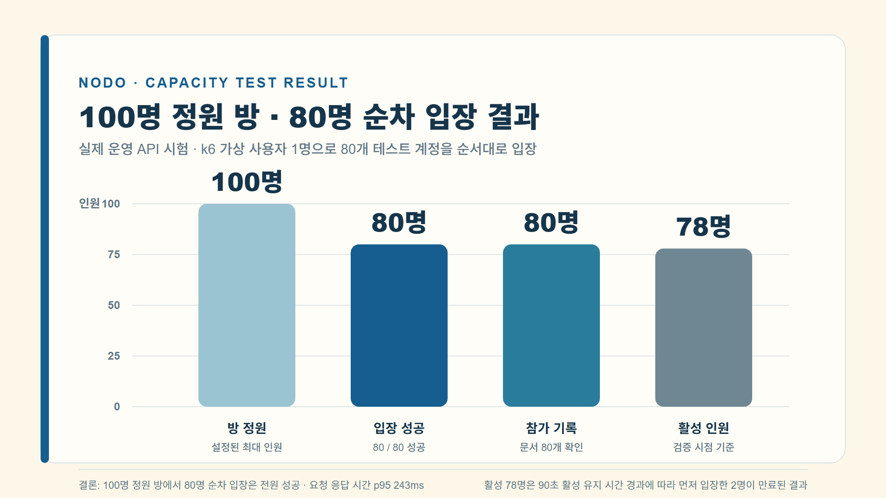
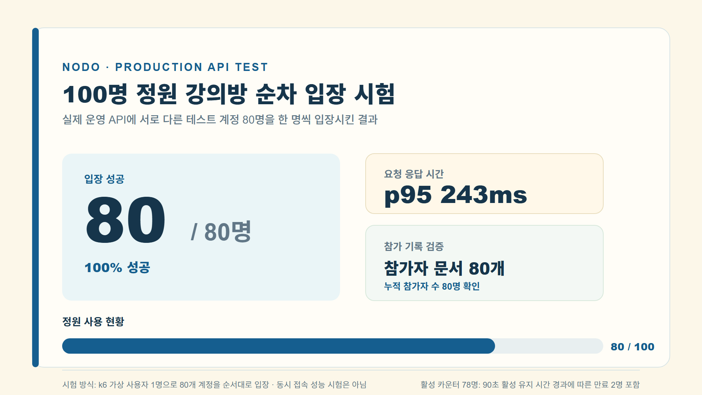
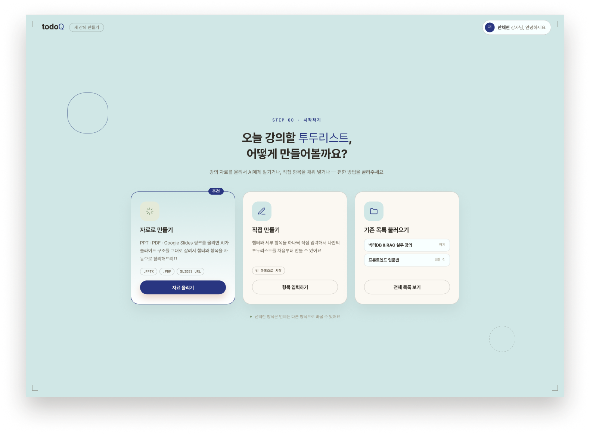
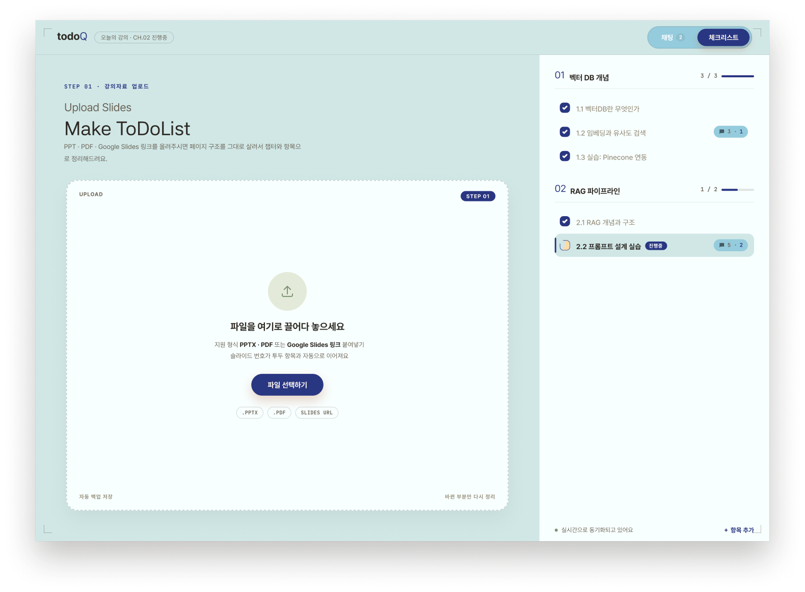
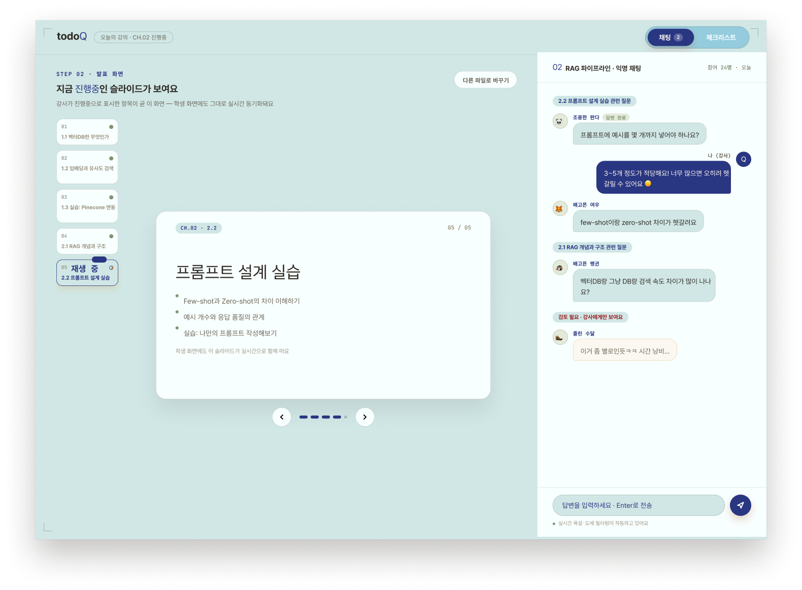
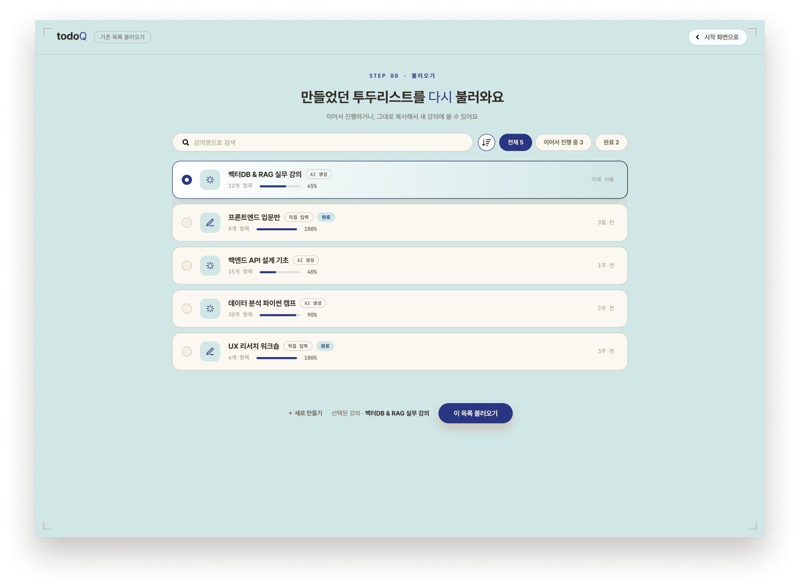

# Google Cloud 기반 수업 운영 플랫폼 NoDo

인턴십 기간에 진행한 **Google Cloud 산학 팀 프로젝트**입니다.  
강사가 강의 자료(PDF·PPTX)를 올리면 AI가 수업 로드맵 초안을 만들고, 학생은 공유 링크로 입장해 현재 진행 위치와 다음 활동을 보면서 질문할 수 있는 **AI 기반 수업 로드맵 및 실시간 강의 운영 플랫폼**입니다.

프론트엔드가 클라우드 저장소에 직접 접근하지 않는 **React → FastAPI → Google Cloud** 구조로 만들고, Cloud Run·Firestore·Cloud Storage·Vertex AI를 사용하는 서버리스 서비스로 배포했습니다.  
인턴이 끝난 뒤에는 백엔드의 설정 검사를 **배포 전에 실행하는 Go CLI(`nodoctl`)** 로 옮겼습니다.

> 원본은 팀 저장소에서 개발했고, 이 폴더는 포트폴리오용으로 옮긴 사본입니다. 실제 GCP 프로젝트 ID, 서비스 주소, 협력 기업의 조직·도메인 정보는 예시 값으로 바꿨고, 인수인계용 접근권한 문서는 제외했습니다.

## 프로젝트 개요

학생이 많은 수업에서는 강사가 모든 학생의 진행 상황을 바로 확인하기 어렵고, 학생은 설명을 한 번 놓치면 이후 흐름을 따라가기 어렵습니다.  
NoDo는 자료, 학습 순서, 수업 운영 정보, 학생 질문을 하나의 흐름으로 연결해 이 문제를 줄이는 것을 목표로 했습니다.

- 강사는 자료를 업로드하거나 직접 로드맵을 작성하고, 학생에게 링크나 방 코드로 공유합니다.
- 학생은 수업 중 현재 항목과 다음 활동을 확인하고, 놓친 부분은 로드맵에 연결된 자료로 다시 돌아갈 수 있습니다.
- 수업이 끝난 뒤에도 강사가 허용한 기간 동안 자료를 다시 볼 수 있습니다.

## 내가 맡은 역할

팀원 1명과 백엔드·클라우드를 함께 맡았고, 그중 **클라우드 인프라와 배포**를 주로 맡았습니다. 서버의 시작 검사는 배포한 뒤에야 실패를 알 수 있어서, 인턴 이후에는 같은 검사를 배포 전에 실행하는 Go CLI(`nodoctl`)도 만들었습니다.

| 영역 | 참여 |
| --- | --- |
| 클라우드 인프라·배포 (자원 경계, 최소 권한, Cloud Run 배포) | 주로 맡은 영역 |
| 배포 전 설정 검사 Go CLI (`nodoctl`) | 인턴 이후 개인 작업 |
| 저장소·동시성 (백엔드) | 팀원과 공동 작업 |

### 배포 전 설정 검사 CLI (`nodoctl`, Go)

인턴 이후 개인적으로 추가한 도구입니다. 자세한 내용은 아래 [Go CLI `nodoctl`](#go-cli-nodoctl) 절에 있습니다.

- 백엔드는 시작할 때 GCP 프로젝트·Storage 버킷·CORS 설정이 정해진 경계와 다르면 아예 시작하지 않습니다. `nodoctl`은 **같은 규칙을 배포 전에 먼저 실행**해, 잘못된 설정이 Cloud Run까지 가기 전에 막습니다.
- 결과를 **종료 코드(통과 0, 차단 1, 사용법 오류 2)** 로 나눠, 파이프라인 단계로 넣으면 차단될 때 배포가 멈추게 했습니다. `--json` 출력도 지원합니다.
- 설정값만 읽고 Firebase나 Google Cloud에 접속하지 않으며, 외부 의존성 없이 Go 표준 라이브러리만 씁니다.
- 규칙이 두 곳에 있으면 어긋나기 쉬워서 테스트로 묶었습니다. **24개 설정 상황**마다 실제 백엔드 검사와 `nodoctl`을 함께 돌려 통과·차단 여부와 오류 메시지가 같은지 비교하고, 백엔드의 고정값(프로젝트, 버킷, CORS 출처 등)이 바뀌면 테스트가 실패합니다.

### 클라우드 인프라·배포

- 여러 서비스가 함께 쓰는 GCP 프로젝트 안에서 자원이 섞이지 않도록 **Firestore 데이터베이스·Storage 버킷·서비스 계정 단위로 자원 경계**를 나누고 명명 규칙을 정했습니다. ([자원 경계 문서](./docs/RESOURCE_BOUNDARIES.md))
- Cloud Run 런타임 서비스 계정에는 NoDo의 Firestore, 전용 버킷, Vertex AI에 필요한 **최소 권한만** 부여하고, 서비스 계정 JSON 키 없이 Application Default Credentials로 인증하도록 구성했습니다.
- FastAPI를 컨테이너로 만들어 Cloud Run(asia-northeast3)에, 웹을 Firebase Hosting에 배포하는 구성을 잡았습니다. 프로젝트·버킷·CORS 설정이 정해진 경계와 다르면 **시작 자체를 멈추는(fail-closed)** 방식으로 잘못된 자원에 연결되는 사고를 막았습니다. ([배포 문서](./docs/NODO_PRODUCTION_DEPLOYMENT.md))
- Firebase Emulator 모드와 실제 클라우드 모드를 분리해, 로컬 개발과 테스트가 운영 데이터에 닿지 않도록 했습니다.

### 저장소·동시성 (백엔드 공동 작업)

- 강의 자료를 **비공개 Cloud Storage 버킷**에만 저장하는 업로드 경로를 만들고, 서버에서 PDF·PPTX 형식을 다시 검사하도록 했습니다.
- 개인·수업·조직 단위 저장 용량을 **Firestore 트랜잭션으로 예약 → 확정 → 해제**하는 방식으로 관리해, 여러 자료를 동시에 올려도 한도를 넘지 않게 했습니다.
- 학생 입장 정원과 접속 상태(heartbeat)를 서버 전용 문서에서 트랜잭션으로 관리했습니다.

### 성능 검증

- k6로 실제 운영 API에 80명 순차 입장 시험을 진행했습니다(p95 약 243ms). 순차 시험이라 경합 자체를 측정하지는 않았고, 입장과 heartbeat가 **정원 카운터 문서 하나에 쓰기를 모으는 구조**여서 동시 접속이 늘면 트랜잭션 경합이 생길 수 있다고 분석해 카운터 샤딩과 heartbeat 처리 분리를 개선 방향으로 정리했습니다.

## 규칙을 배포 전으로 당긴 과정

이 프로젝트에서 한 일은 세 단계로 이어집니다.

| 단계 | 한 일 | 막는 것 |
| --- | --- | --- |
| 1. 경계를 정함 | Firestore 데이터베이스, 버킷, 서비스 계정을 서비스 단위로 나누고 문서로 남김 | 같은 GCP 프로젝트를 쓰는 다른 서비스의 자원에 닿는 일 |
| 2. 서버가 지키게 함 | 설정이 경계와 다르면 서버가 시작하지 않음(fail-closed) | 잘못된 설정으로 운영 트래픽을 받는 일 |
| 3. 배포 전에 검사함 | 같은 규칙을 Go CLI로 옮기고 종료 코드로 결과를 알림 | 잘못된 설정이 배포 단계까지 가는 일 |

서버의 시작 검사는 마지막 방어선이라, 실패를 알게 되는 시점이 배포 이후입니다. 같은 검사를 CLI로 옮기면 개발자가 배포를 시작하기 전에 결과를 받습니다. 규칙이 서버와 CLI 두 곳에 있어도 어긋나지 않도록, 둘의 판정을 비교하는 테스트를 함께 두었습니다.

## Go CLI `nodoctl`

Python으로 된 백엔드의 설정 규칙(`backend/app/core/config.py`)을 Go로 옮긴 명령줄 도구입니다. Go 코드 약 500줄, 테스트 약 250줄이고 코드는 [tools/nodoctl](./tools/nodoctl)에 있습니다.

### 사용법

```bash
cd tools/nodoctl
go test ./...
go build -o nodoctl .
./nodoctl check --env-file ../../.env.example
```

| 명령 | 설명 |
| --- | --- |
| `nodoctl check --env-file PATH` | 파일의 설정만 검사 |
| `nodoctl check --with-process-env` | 현재 셸 환경 변수로 검사 (`--env-file`과 함께 쓰면 파일 값이 덮어씀) |
| `nodoctl check --json` | 결과를 JSON으로 출력 |
| `nodoctl version` | 버전 출력 |

검사마다 `PASS`, `FAIL`(사유 포함), `SKIP`(해당 기능이 꺼져 있음) 중 하나를 한 줄씩 출력합니다. 종료 코드는 통과 0, 차단 1, 사용법 오류 2라서, 파이프라인의 한 단계로 넣으면 차단될 때 다음 단계로 넘어가지 않습니다.

### 실행 결과

아래는 이 저장소의 파일로 직접 실행한 결과입니다(Go 1.27.4, 2026-11-23).

Cloud Run 배포용 예시 설정(`backend/.env.cloud-run.example`)은 통과합니다.

```console
$ ./nodoctl check --env-file ../../backend/.env.cloud-run.example
PASS  startup
PASS  storage_uploads
SKIP  vertex_drafts (feature disabled)
SKIP  vertex_assistant (feature disabled)
$ echo $?
0
```

같은 설정에서 Storage 버킷만 다른 팀의 버킷으로 바꾸면 차단됩니다.

```console
$ ./nodoctl check --env-file wrong-bucket.env
FAIL  startup: The configured NoDo Storage bucket is not allowed
FAIL  storage_uploads: The configured NoDo Storage bucket is not allowed
SKIP  vertex_drafts (feature disabled)
SKIP  vertex_assistant (feature disabled)
$ echo $?
1
```

`--json`을 붙이면 같은 결과를 다른 도구가 읽을 수 있는 형태로 출력합니다.

```console
$ ./nodoctl check --env-file wrong-bucket.env --json
{
  "checks": {
    "startup": "The configured NoDo Storage bucket is not allowed",
    "storage_uploads": "The configured NoDo Storage bucket is not allowed"
  },
  "skipped": [
    "vertex_drafts",
    "vertex_assistant"
  ]
}
```

설정 파일이 없으면 검사 결과와 구분되도록 종료 코드 2로 끝납니다.

```console
$ ./nodoctl check --env-file missing.env
nodoctl: open missing.env: no such file or directory
$ echo $?
2
```

테스트는 5개가 모두 통과합니다. 그중 `TestCheck`는 11개 상황, `TestParityWithBackend`는 24개 상황을 각각 실행합니다.

```console
$ go test ./...
ok  	nodoctl	3.481s
```

### 검사하는 것

| 검사 | 언제 | 예시로 막는 설정 |
| --- | --- | --- |
| `startup` | 항상 | 에뮬레이터 모드인데 실제 프로젝트 지정, 운영에 에뮬레이터 변수가 남음, 서비스 계정 키 파일 지정, 허용되지 않은 CORS 출처 |
| `storage_uploads` | Storage를 클라우드 모드로 쓸 때 | 다른 버킷이나 다른 GCP 프로젝트 |
| `vertex_drafts`, `vertex_assistant` | Vertex AI를 쓸 때 | 허용되지 않은 Gemini 모델, 엔드포인트, 입력 한도 |

### 코드 구성

| 파일 | 내용 |
| --- | --- |
| `main.go` | 명령과 플래그 처리, 검사 결과 보고서, 종료 코드 |
| `settings.go` | 설정 읽기와 검사 규칙 (백엔드와 같은 순서로 실행) |
| `env.go` | 환경 변수와 `KEY=VALUE` 파일 읽기 (주석, `export` 접두어, 따옴표 처리) |
| `settings_test.go` | 설정 상황별 판정, env 파일 읽기, 종료 코드, 백엔드 고정값 비교 |
| `parity_test.go`, `testdata/backend_check.py` | 실제 백엔드 검사와 판정 비교 |

### 설계하면서 정한 것

- **표준 라이브러리만 씁니다.** 외부 의존성이 없어 `go build` 한 번으로 실행 파일 하나가 나오고, 파이프라인 이미지에 넣기 쉽습니다.
- **네트워크에 접속하지 않습니다.** 설정값만 읽기 때문에 배포 권한이나 클라우드 인증 없이 어디서나 실행할 수 있습니다.
- **백엔드와 같은 순서, 같은 오류 메시지로 검사합니다.** 서버가 시작을 멈출 때 내는 메시지와 같아서, 어느 규칙에 걸렸는지 바로 알 수 있습니다.
- **백엔드 이미지에는 넣지 않습니다.** 배포 전에만 쓰는 도구라 운영 이미지를 키우지 않습니다.

### 테스트

- `TestCheck`: 정상 설정 2개와 차단돼야 하는 설정 9개(다른 버킷, 남아 있는 에뮬레이터 변수, 서비스 계정 키 파일, 허용되지 않은 CORS 출처 등)의 판정을 확인합니다.
- `TestExitCodes`: 통과 0, 없는 파일이나 명령 누락 2를 확인합니다.
- `TestBackendConstantsMatch`: 백엔드 `config.py`의 고정값 10개와 직원 이메일 도메인을 읽어 이 도구의 값과 비교합니다. 백엔드 값만 바꾸고 이 도구를 고치지 않으면 실패합니다.
- `TestParityWithBackend`: **24개 설정 상황**마다 실제 백엔드 검사를 Python으로 실행하고, `nodoctl`의 통과·차단 여부와 오류 메시지가 같은지 비교합니다.

## 시스템 구조

```text
브라우저 (React + Vite, Firebase Hosting)
   │  Firebase Authentication (강사: Google 로그인 / 학생: 익명 인증)
   ▼
FastAPI (Cloud Run)  ── 권한·수업 상태·용량 검증을 모두 서버에서 처리
   ├─▶ Cloud Firestore   조직·수업·로드맵·참가자·질문·감사 기록
   ├─▶ Cloud Storage     강의 자료 원본 (비공개 버킷)
   └─▶ Vertex AI Gemini  요청할 때만 로드맵 초안 생성
```

| 서비스 | 활용 내용 |
| --- | --- |
| Firebase Authentication | Google 로그인, 세션 검증, 조직 승인 이메일과 로그인 이메일 일치 확인 |
| Cloud Run | FastAPI 백엔드 운영. 수업·질문·참여자·자료 접근 요청 처리 |
| Cloud Firestore | 조직 구성원, 수업, 로드맵, 참가자, 질문, 권한, 감사 기록 저장 |
| Cloud Storage | PDF·PPTX 강의 자료 원본과 처리 결과 저장 |
| Firebase Hosting | React/Vite 웹 화면 배포 |
| Vertex AI | 업로드한 자료를 바탕으로 로드맵 초안 생성 |

## 핵심 기능

### 1. 자료 기반 로드맵 생성과 편집

- PDF·PPTX를 브라우저와 서버에서 각각 형식 검사한 뒤 비공개 Storage에 저장합니다.
- 강사가 요청하면 Vertex AI Gemini가 정규화된 텍스트만 받아 챕터·항목 단위 로드맵 초안을 만듭니다.
- 편집 화면에서 제목과 설명을 고치고, 챕터·항목 순서를 드래그로 바꿀 수 있습니다.

### 2. 실시간 수업 운영

- 수업 상태를 준비 중(READY), 진행 중(LIVE), 종료됨(ENDED)으로 관리합니다.
- 강사는 정원을 정하고, 학생 입장 링크와 8자리 방 코드를 공유합니다.
- 자료 미리보기와 로드맵 진행 패널을 함께 보여주고, 학생 질문은 해당 항목의 문맥과 함께 기록됩니다.

### 3. 수업 종료 후 자료 열람과 데이터 수명주기

- 종료 후 자료 열람 기간을 즉시·1일·7일·30일·직접 지정 중에서 고릅니다.
- 종료된 수업은 체크리스트 변경과 새 질문을 막아 기록이 바뀌지 않게 합니다.
- 상세 질문·참가 정보 같은 개인정보성 데이터는 열람 마감 이후 정리 대상으로 분류했고, 정리가 늦어져도 API가 마감 이후 다운로드를 먼저 차단합니다.

### 4. 조직·권한·용량 관리

- 관리자가 회사 Google 이메일을 사전 승인하면, 그 사용자가 같은 이메일로 로그인할 때 조직 멤버십이 활성화됩니다.
- 구성원을 제거해도 Google 계정은 지우지 않고 조직 멤버십만 제거하며, 진행 중인 수업의 주 강사 권한은 관리자에게 자동으로 넘어갑니다.
- 자료 업로드는 개인·수업·조직 단위 용량을 바이트 기준으로 검사합니다. 업로드 전에 용량을 **예약**하고, 성공하면 확정하고, 실패하면 해제해 동시 업로드에서도 한도를 넘지 않게 했습니다.

## 사용 기술

- 클라우드: `Cloud Run`, `Cloud Firestore`, `Cloud Storage`, `Firebase Authentication`, `Firebase Hosting`, `Vertex AI (Gemini)`
- 도구: `Go` (배포 전 설정 검사 CLI), `Docker`, `k6`, `Firebase Emulator Suite`(Auth·Firestore·Storage)
- 백엔드: `Python`, `FastAPI`, `pytest`, `Ruff`
- 프론트엔드: `React`, `TypeScript`, `Vite`, `Vitest`

## 구현 포인트

- 브라우저는 Firestore·Storage·Vertex AI에 직접 접근하지 않고 **모든 요청을 FastAPI에서 검증**하도록 해, 역할 기반 권한과 개인정보 최소 노출 원칙을 한곳에서 지켰습니다.
- 로컬 개발은 Firebase Emulator로, 실제 인증 연동은 별도의 `cloud-auth` 모드로 **실행 모드를 분리**했습니다. 필수 환경 변수가 하나라도 빠지면 실제 프로젝트로 추측 연결하지 않고 시작을 멈춥니다.
- 프론트엔드(Vitest) 504개, 백엔드(pytest) 456개 테스트가 기본 로컬 설정에서 통과하며, Emulator 기반 Firestore 보안 규칙 테스트와 함께 권한·상태 변경·용량 관리 동작을 검증했습니다. 나머지 백엔드 테스트 29개는 클라우드 인증 설정(실제 CORS 출처 등)이 있어야 실행되는 테스트입니다.

## 운영 검증

실제 운영 API에서 정원 100명인 임시 수업에 서로 다른 테스트 계정 80명을 순서대로 입장시키는 시험을 했습니다.

- 80명 모두 입장에 성공했고, 입장 API의 p95 응답 시간은 **약 243ms**였습니다.
- 다수 학생의 입장과 heartbeat 요청이 같은 정원 카운터 문서를 갱신하는 구조라 **Firestore 트랜잭션 경합**이 생길 수 있다는 점을 확인했고, 정원 카운터 샤딩과 heartbeat 처리 개선을 다음 과제로 정리했습니다.
- 이 시험은 가상 사용자 1명이 계정을 바꿔 가며 순차로 입장한 방식이라, 80명 동시 접속 성능을 보장하는 결과는 아닙니다.

| 순차 입장 시험 결과 | 시험 요약 |
| --- | --- |
|  |  |

## 화면 디자인 (초기 시안)

| 시작 화면 | 자료 업로드 |
| --- | --- |
|  |  |

| 수업 진행·채팅 | 저장된 수업 불러오기 |
| --- | --- |
|  |  |

## 확인할 파일

- `tools/nodoctl/`
  - 배포 전 설정 검사 Go CLI와 백엔드 비교 테스트 (인턴 이후 개인적으로 추가)
- `backend/app/core/config.py`
  - 서버 시작 검사(fail-closed) 규칙
- `docs/`
  - 자원 경계, 배포 문서, API 계약, Firestore 스키마, 역할·권한
- `backend/app/`, `backend/tests/`
  - FastAPI 라우트, 도메인 규칙, Firestore·Storage·Vertex AI 어댑터와 테스트
- `web/src/`
  - React 화면과 기능별 모듈, 컴포넌트 테스트
- `firestore.rules`, `storage.rules`, `web/emulator-tests/`
  - 보안 규칙과 Emulator 기반 규칙 테스트
- `docs/DEVELOPER_GUIDE.md`
  - 실행 모드, 환경 변수, 로컬 실행 방법 (원본 저장소 README)

## 프로젝트 의미

실제 기업 환경에서 쓸 수 있는 서비스를 목표로, **권한·개인정보·비용·데이터 수명주기까지 함께 설계**해 본 프로젝트입니다.  
한 GCP 프로젝트를 여러 서비스가 함께 쓰는 환경에서는 설정 하나가 사고로 이어질 수 있다는 것을 알게 됐고, 그래서 지켜야 할 경계를 문서로만 두지 않고 서버의 시작 검사와 배포 전 CLI로 옮겼습니다. 규칙을 코드에 넣으면 사고를 미리 막을 뿐 아니라, 배포할 때 사람이 확인해야 할 것도 줄어든다는 것을 이 과정에서 배웠습니다.  
성능 시험에서는 한 문서에 쓰기가 몰리는 구조가 트랜잭션 경합으로 이어질 수 있다는 점을 확인했고, 관리형 서비스를 쓰더라도 자원 격리와 경합을 이해해야 한다는 것을 느꼈습니다.
