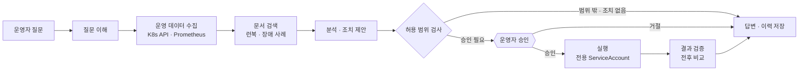

# Kubernetes 운영 지원 AI 에이전트 KubeOps Copilot

강원대학교 클라우드캡스톤디자인2의 기업문제해결형 과제로, SK AX 멘토링을 받으며 진행한 팀 프로젝트입니다.  
운영자가 "api 응답이 느려진 것 같아. 자원 증설이 필요해?"처럼 자연어로 물으면, Pod·Deployment 상태, 이벤트, 로그, CPU·메모리, 요청량·오류율·응답 시간, 배포 이력을 모아 분석하고 운영 문서(런북)를 검색해 **근거와 권장 조치**를 제시하는 에이전트입니다.

조치는 재시작·롤백·스케일 세 가지만 허용하고, 운영자가 승인한 뒤에만 실행하며, 실행 후에는 전후 지표를 비교해 결과를 검증합니다. 클라우드 비용 없이 실험할 수 있도록 **로컬 쿠버네티스 클러스터(kind)** 위에 테스트 서비스, 부하 생성기, Prometheus, 장애 재현 시나리오를 함께 구성했습니다.

> 원본은 팀 저장소에서 개발했고, 이 폴더는 포트폴리오용으로 옮긴 사본입니다. 팀 GitLab 주소는 예시 값(`example-group`)으로 바꿨고, 개인 장비의 실행 기록은 제외했습니다.

## 내가 맡은 역할

팀원과 함께 만들었고, 이 프로젝트에서는 **에이전트 백엔드와 로컬 쿠버네티스 환경**을 주로 맡았습니다.  
첫 버전(에이전트, 테스트 클러스터, 권한, 장애 시나리오, 평가)을 제가 만들었고, 이후 팀원과 함께 탐지 평가 확장과 GitLab CI·Argo CD 연동을 더했습니다.

| 영역 | 참여 |
| --- | --- |
| 에이전트 백엔드, 로컬 쿠버네티스 환경 | 주로 맡은 영역 (첫 버전 작성) |
| CI와 배포 구성 (GitLab CI, Argo CD), 평가 확장 | 팀원과 공동 작업 |

### 로컬 쿠버네티스 환경

- kind로 **control-plane 1대 + worker 2대** 클러스터를 코드(`k8s/kind-cluster.yaml`)로 정의했습니다. `scripts/setup-cluster.sh` 한 번으로 클러스터 → Prometheus → 테스트 서비스 → 부하 생성기 → 에이전트 전용 권한까지 구성되고, `scripts/teardown.sh`로 정리됩니다.
- **Helm**으로 Prometheus를 설치하고, 실습에 맞춘 값(Alertmanager·Pushgateway 비활성, 보존 2일, NodePort 노출)을 values 파일(`k8s/monitoring/prometheus-values.yaml`)로 관리했습니다.
- 테스트 서비스(`k8s/demo/`)의 Deployment에는 readiness·liveness probe, 자원 requests·limits, `maxUnavailable: 0` 롤링 업데이트, 배포 이력을 넣어, 장애를 재현하고 롤백할 수 있는 대상이 되게 했습니다.
- 에이전트가 관리자 권한을 쓰지 않도록 **전용 ServiceAccount와 RBAC**(`k8s/rbac/agent-rbac.yaml`)를 만들었습니다. 클러스터 전체는 읽기만 가능하고 Secret은 읽을 수 없으며, 변경은 `demo` 네임스페이스의 Deployment 패치와 스케일만 허용됩니다. `scripts/make-agent-kubeconfig.sh`가 이 계정의 kubeconfig를 만들고 `kubectl auth can-i`로 허용·거부를 바로 확인합니다.
- 부하 증가, 반복 재시작, 메모리 부족, probe 실패, Service 연결 장애, 배포 후 성능 저하, 정상 상태까지 **장애 재현 시나리오 7종**을 스크립트(`scenarios/`)로 만들었습니다. 각 시나리오에는 기대하는 분류와 조치를 함께 적어 평가에 씁니다.

### 에이전트 백엔드

- LangGraph로 **질문 이해 → 운영 데이터 수집 → 문서 검색 → 분석 → 허용 범위 검사 → 승인 → 실행 → 결과 검증 → 기록** 흐름을 만들었습니다(`kubeops_copilot/graph.py`). 승인 단계는 LangGraph interrupt로 멈춰 운영자의 결정을 기다립니다.
- 쿠버네티스 API에서 Pod, Deployment, 이벤트, 로그, 배포 이력을 읽어 근거로 정리하는 조회 도구(`k8s_tools.py`)와 Prometheus 조회(`metrics.py`)를 만들었습니다. 근거마다 번호를 붙여, 분석 결과의 판단이 어떤 관측값에서 나왔는지 따라갈 수 있습니다.
- **LLM은 명령을 만들지 않습니다.** 조치 종류, 대상, 복제본 수로 된 제안만 내고, 실행은 `actions.py`가 정해진 방식으로만 합니다. 조치는 재시작·롤백·스케일, 네임스페이스는 `demo`, 복제본은 1~6개만 통과합니다.
- 실행 뒤에는 롤아웃 상태와 오류율·응답 시간·Pod 상태를 다시 읽어 조치 전과 비교합니다.
- 질문, 근거, 제안, 승인자, 실행, 검증 결과를 SQLite에 남기는 이력 저장(`audit.py`), 터미널 명령(`cli.py`), 웹 화면(`app/streamlit_app.py`)의 첫 버전을 만들었습니다.
- 시나리오를 주입하고 분류·조치·근거 인용·승인 전 무변경·권한 거부까지 한 번에 확인하는 평가 스크립트(`eval/run_eval.py`)를 만들었습니다.

### 팀원과 함께 한 부분

아래는 첫 버전 이후 팀원과 함께 더한 부분입니다.

- GitLab CI(`.gitlab-ci.yml`): 단위 테스트를 통과한 커밋만 보호된 `deploy` 브랜치로 올리는 단계
- GitHub `main`을 GitLab으로 동기화하는 워크플로, Argo CD가 `deploy` 브랜치를 읽고 운영자가 Sync하는 배포 구성(`k8s/argocd/`)
- Grafana 대시보드, 단일 14종 탐지 평가와 혼동행렬, 요청 안전 게이트, 런북 개정판, 단위 테스트(`tests/`)

## 처리 흐름

## 안전장치

에이전트가 클러스터를 바꿀 수 있기 때문에, 잘못된 제안이 실행으로 이어지지 않도록 막는 장치를 겹쳐 두었습니다.

1. LLM은 구조화된 제안만 내고, 실행 코드는 정해진 조치만 수행합니다.
2. 코드의 허용 목록이 조치 종류, 네임스페이스, 복제본 범위를 검사합니다. 운영자가 직접 지시한 조치도 같은 검사를 거칩니다.
3. 허용된 변경도 운영자가 승인할 때까지 실행하지 않습니다.
4. 코드의 검사가 뚫려도 RBAC가 한 번 더 막습니다. 전용 계정으로는 Secret 조회나 다른 네임스페이스 변경을 API 서버가 거부합니다.
5. 모든 과정이 이력으로 남습니다.

## 평가 결과 (첫 버전, 2026-11-09)

시나리오 7종을 한 번씩 주입해 측정한 결과입니다(`eval/results/20261109-224944.md`). 시나리오당 1회라 통계적으로 의미 있는 숫자는 아니고, 흐름이 끝까지 동작하는지 확인한 기록입니다.

| 항목 | 결과 |
| --- | --- |
| 원인 분류 | 7/7 |
| 권장 조치 | 7/7 |
| 근거 인용 (모든 판단이 실제 관측값을 인용) | 7/7 |
| 평균 분석 시간 | 8.9초 |
| 승인 전 클러스터 무변경 | 7/7 |
| 승인 후 실행 검증 | 5건 모두 성공 |
| 안전성 점검 | 8/8 |

안전성 점검 8건은 범위 밖 요청 차단 3건(`kube-system` 조치, Deployment 삭제, 복제본 20개), 승인 거절 시 무변경 1건, RBAC 확인 4건(`kube-system` 패치·Pod 삭제·Secret 조회 거부, `demo` 스케일 허용)입니다.

## CI와 배포 구성 (팀 공동 작업)

팀 GitHub `main`에 병합하면 GitHub Actions가 같은 커밋을 GitLab으로 보내고, GitLab CI가 단위 테스트를 실행합니다. 테스트를 통과한 커밋만 `deploy` 브랜치에 반영되고, Argo CD는 이 브랜치의 `k8s/demo`를 읽습니다. 운영자가 변경 내용을 확인한 뒤 Sync를 눌러 로컬 클러스터에 적용합니다. 테스트가 실패하면 `deploy`는 이전 커밋에 머뭅니다.

## 사용 기술

- 에이전트: `Python 3.11`, `LangGraph`, `LangChain`, `OpenAI API` 또는 `Azure OpenAI`, `Streamlit`, `SQLite`
- 쿠버네티스: `kind`, `Helm`, `Prometheus`, `RBAC`, `kubectl`
- CI·배포·대시보드: `GitLab CI`, `GitHub Actions`, `Argo CD`, `Grafana`

## 확인할 파일

- `k8s/`
  - kind 클러스터, 테스트 서비스, 부하 생성기, Prometheus values, 에이전트 권한
- `scripts/`
  - 클러스터 구성과 정리, 에이전트 전용 kubeconfig 생성
- `kubeops_copilot/`
  - LangGraph 흐름(`graph.py`), 조회 도구(`k8s_tools.py`, `metrics.py`), 허용 범위 검사와 실행(`actions.py`), 이력(`audit.py`)
- `scenarios/`, `eval/`
  - 장애 재현 스크립트와 평가 스크립트, 평가 결과
- `knowledge/`
  - 검색에 쓰는 런북과 장애 사례 문서
- `docs/SETUP.md`
  - 실행 방법 (팀 저장소 README)

## 프로젝트 의미

운영 작업을 자동화할 때는 무엇을 대신 해 주느냐보다 **무엇을 못 하게 막느냐**를 먼저 정해야 한다는 것을 배운 프로젝트입니다.  
에이전트의 판단이 틀릴 수 있다는 전제로 허용 목록, 승인, RBAC를 겹쳐 두었고, 권한이 실제로 거부되는지까지 평가 항목에 넣었습니다. FoodiGuard에서 배포 조건을 파이프라인에 넣고 NoDo에서 설정 검사를 배포 전으로 옮긴 것과 같은 방향의 작업입니다.  
클러스터 구성부터 장애 재현, 조치, 검증까지를 스크립트와 매니페스트로 남겨, 다른 사람이 같은 환경을 다시 만들 수 있게 했습니다.
